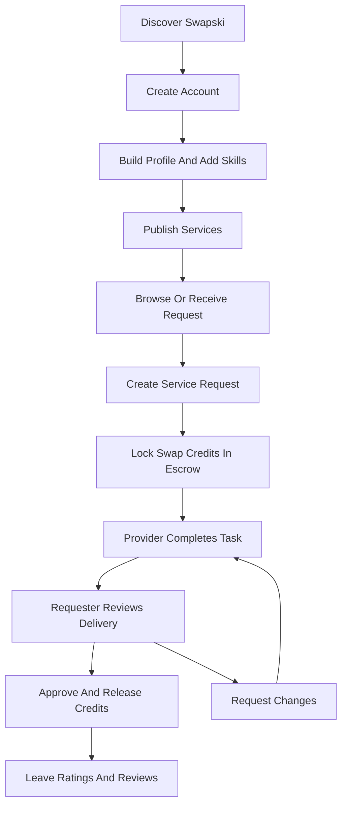

## 1. Product Overview
Swapski is a premium skill-exchange marketplace where users earn Swap Credits by helping others and spend those credits to receive help, without direct money payments between members.

- This PRD formalizes the current prompt and the provided presentation imagery into a build-ready product definition. No separate blueprint file was present in the local workspace at the time of generation, so business rules below capture the current source-of-truth interpretation for implementation approval.
- The product targets students, early-career professionals, creators, and communities who have valuable skills but limited budgets, creating a trust-based marketplace powered by credit escrow instead of cash.

## 2. Core Features

### 2.1 User Roles
| Role | Registration Method | Core Permissions |
|------|---------------------|------------------|
| Guest | No registration | View landing page, browse preview content, open onboarding prompts |
| Member | Email/password or social-style mock sign-in | Create profile, add skills, publish services, request services, manage wallet, message users, complete tasks, rate exchanges |
| Platform Admin (future backend role) | Internal only | Review disputes, moderate services, monitor credit ledger, manage trust and safety workflows |

### 2.2 Feature Module
1. **Landing Page**: premium hero, trust narrative, value proposition, step-by-step flow, service categories, testimonials, FAQ, call-to-action.
2. **Onboarding & Authentication**: sign-up, sign-in, welcome wizard, profile completion, skills/interests selection, service intent setup.
3. **Dashboard**: personalized summary, active swaps, wallet snapshot, recommendations, progress tracker, notifications, quick actions.
4. **Marketplace**: service discovery, category filters, featured providers, search, service detail modal/panel, request initiation.
5. **Profile & Services**: public profile, trust stats, skills portfolio, service cards, availability, ratings, edit profile, create service flow.
6. **Requests & Escrow**: request creation, credit lock confirmation, status timeline, delivery checkpoints, approval/release flow, dispute placeholder.
7. **Wallet & Ledger**: immutable Swap Credit transaction history, escrow states, earned/spent summaries, pending releases, analytics.
8. **Messaging**: threaded conversations, contextual task chat, attachments UI placeholders, quick templates, status-linked updates.
9. **Task Management**: kanban/timeline style active work, milestones, due dates, progress states, review actions, completion confirmation.
10. **Settings**: account preferences, notifications, appearance, privacy, security mock controls, help/support surfaces.

### 2.3 Page Details
| Page Name | Module Name | Feature description |
|-----------|-------------|---------------------|
| Landing Page | Hero | Present “Exchange Skills. Not Money.” with animated cyber-terminal branding, premium gradients, key metrics, and CTA into onboarding |
| Landing Page | Problem/Solution Story | Show the affordability problem, then explain the credit-based value exchange with visual storytelling |
| Landing Page | How It Works | Explain account creation, skill setup, task completion, credit earning, service request, escrow release, and ratings |
| Landing Page | Featured Skills | Showcase popular categories such as design, development, tutoring, editing, research, and marketing |
| Onboarding | Account Setup | Mock authentication states with email, password, social options, and success transition into profile creation |
| Onboarding | Profile Builder | Collect name, headline, bio, skills, interests, timezone, availability, and portfolio snippets |
| Dashboard | Overview Cards | Display wallet total, credits in escrow, active swaps, completion rate, response time, and rating |
| Dashboard | Activity Feed | Show recent earnings, requests, releases, approvals, and pending actions |
| Marketplace | Search & Filters | Filter by category, credit range, delivery speed, rating, and availability |
| Marketplace | Service Cards | Show service title, provider, tags, credit cost, delivery estimate, trust stats, and hover reveal details |
| Marketplace | Request Drawer | Confirm service request, summarize terms, preview escrow impact, and start the swap |
| Profile | Public Reputation | Show trust score, completed swaps, ratings breakdown, top skills, testimonials, and active services |
| Services | Create/Edit Service | Define title, description, skill tags, delivery time, revisions, credit price, and portfolio preview |
| Requests | Escrow Timeline | Track requested, accepted, in progress, delivered, reviewing, completed, and disputed states |
| Wallet | Transaction Ledger | Render immutable ledger entries for credit earn, credit lock, release, refund, adjustment, and pending states |
| Messaging | Conversation View | Chat UI linked to a specific request with system activity markers and task context |
| Task Management | Workboard | Organize swaps by pending, in progress, review, and completed with timeline indicators |
| Settings | Preferences | Mock editable notification, profile visibility, security, theme, and billing-disabled sections |

## 3. Core Process
Primary user journey:
1. A new user discovers Swapski through the landing page and understands that skills can be exchanged using Swap Credits instead of money.
2. The user creates an account, completes their profile, and adds both offered skills and desired services.
3. The user publishes one or more service listings with credit pricing and delivery expectations.
4. Another user browses the marketplace, reviews a provider profile, and submits a service request.
5. The requester locks the required Swap Credits into escrow before work begins.
6. The provider completes the task, shares delivery through task/chat views, and marks the service as ready for review.
7. The requester approves the result, releasing escrowed credits to the provider through an immutable ledger event.
8. Both users leave ratings and reviews, strengthening the trust system for future exchanges.

## 4. User Interface Design

### 4.1 Design Style
- **Primary palette**: midnight navy `#050816`, surface `#0D1326`, elevated card `#131C31`, primary text `#FFFFFF`, secondary text `#A7B3D0`
- **Accent palette**: electric cyan `#39D0FF`, vibrant purple `#7B61FF`, success `#37E28C`, warning `#F8B84E`, error `#FF5C7C`
- **Visual direction**: cyber-terminal futurism with venture-backed SaaS refinement; soft glassmorphism, subtle neon glow, mesh gradients, blurred orbs, thin grid overlays, animated connection lines
- **Buttons**: rounded 18px to 22px, bright gradient primary actions, glass secondary actions, hover lift and glow intensification
- **Typography**: premium modern sans stack aligned to user requirement, with large bold headings and clean supporting hierarchy
- **Layout style**: desktop-first modular dashboard, premium card system, edge-to-edge hero moments, responsive side navigation on app screens
- **Iconography**: thin, modern, slightly futuristic line icons with glowing state cues
- **Motion**: page fades, staggered reveal, hover float, animated counters, shimmering skeletons, subtle particle drift, timeline progress transitions

### 4.2 Page Design Overview
| Page Name | Module Name | UI Elements |
|-----------|-------------|-------------|
| Landing Page | Hero | Full-screen layered background, floating product cards, animated metrics, logo lockup, premium CTA pair |
| Landing Page | Problem/Solution | Split storytelling layout, terminal-style labels, highlighted proof points, visual sequence cards |
| Landing Page | How It Works | Numbered process rail, animated arrows, glowing cards, supportive illustrations |
| Onboarding | Wizard | Multi-step card, progress bar, animated step transitions, interactive chips for skills/interests |
| Dashboard | Summary | KPI cards, activity timeline, quick-create modules, recommendation carousel |
| Marketplace | Discover Grid | Search shell, filter chips, category pills, service cards with provider preview and gradient hover border |
| Profile | Reputation View | Hero profile card, achievement strip, skill tags, review sections, services gallery |
| Requests | Escrow Workflow | Timeline, status chips, detail side panel, approve/revise actions, transaction preview |
| Wallet | Ledger | Balance card, inflow/outflow charts, immutable transaction table, pending escrow blocks |
| Messaging | Chat Interface | Left thread list, conversation panel, system event badges, contextual request summary |
| Task Management | Workboard | Kanban lanes, countdown pills, priority tags, milestone cards |
| Settings | Preferences | Sectioned cards, switches, inline forms, disabled future-backend controls |

### 4.3 Responsiveness
- Desktop-first with premium multi-column layouts from `1200px+`
- Tablet adaptation through stacked summaries, collapsible navigation, and reduced decorative density
- Mobile optimization through bottom navigation, single-column cards, sticky key actions, larger touch targets, and preserved hierarchy
- Motion should gracefully reduce on smaller or reduced-motion devices while maintaining polish

### 4.4 Interaction & Trust Guidance
- Escrow states must always be visible and understandable through labels, tooltips, and timelines
- Credits are represented as ledger events, not directly edited balances
- Ratings, completion counts, and response time should visually reinforce trust
- Empty states should educate users on how to earn or spend Swap Credits next
- Mock backend states should feel real through loaders, optimistic transitions, and persistent local session state
