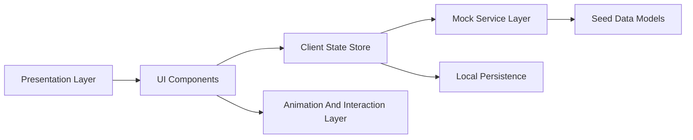
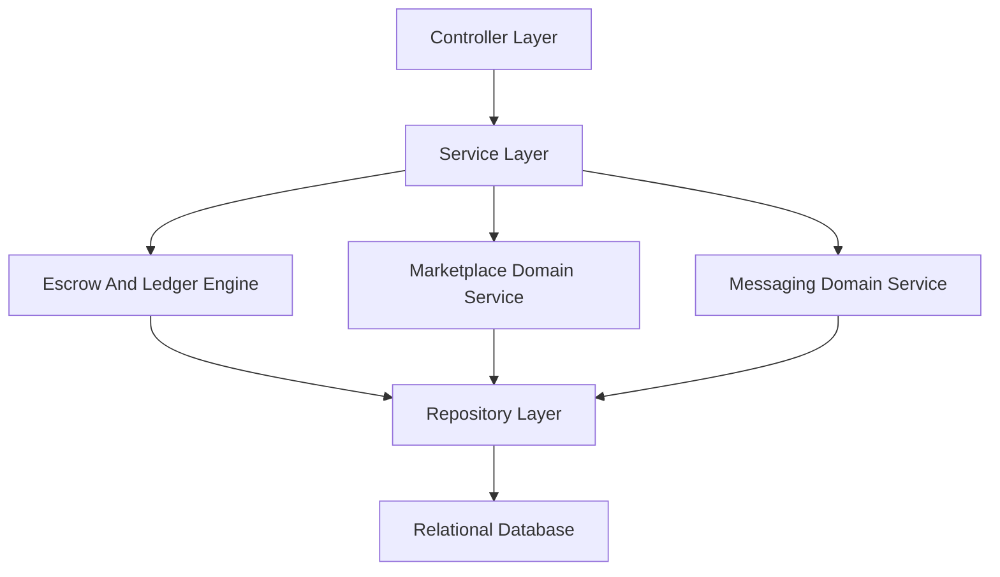
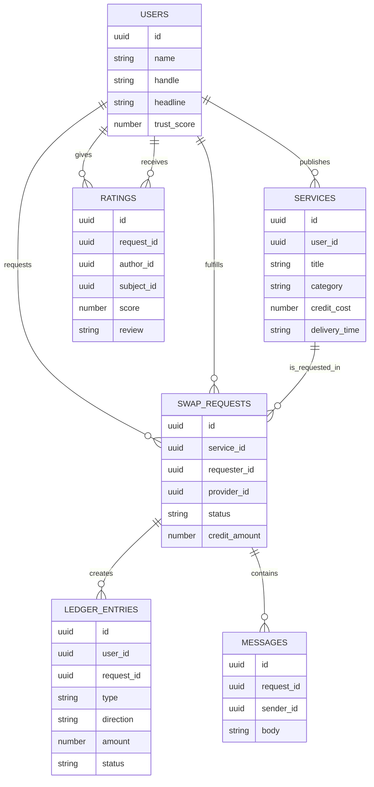

## 1. Architecture Design
The implementation will be a frontend-only, production-quality single-page web application using modular HTML, CSS, and JavaScript with Bootstrap utilities and components where useful. Backend behavior will be simulated through local state, seeded datasets, and deterministic UI flows so the product feels operational while preserving clean boundaries for a future real backend.



## 2. Technology Description
- Frontend: HTML5 + CSS3 + JavaScript (ES6 modules pattern within a single deployable static app)
- UI Foundation: Bootstrap 5 for responsive grid, utilities, modal/offcanvas helpers, and form structure
- Styling Strategy: custom design system with CSS variables, premium component styling, animation keyframes, and responsive breakpoints
- State Management: lightweight in-browser state store using plain JavaScript objects plus `localStorage` persistence
- Data Strategy: seeded JSON-like in-memory structures for users, services, requests, messages, ratings, and immutable wallet ledger entries
- Delivery Model: static hosting compatible, no backend dependency, ready for later API integration

## 3. Route Definitions
Because the app is frontend-only, route changes will be handled as hash-based or section-based views within one `index.html`.

| Route | Purpose |
|-------|---------|
| `#/landing` | Public homepage and marketing experience |
| `#/auth` | Mock sign-in and account creation flow |
| `#/onboarding` | Profile and skill setup wizard |
| `#/dashboard` | Personalized overview after sign-in |
| `#/marketplace` | Discover services and open request flow |
| `#/profile` | View/edit member profile and services |
| `#/requests` | Track request lifecycle and escrow statuses |
| `#/wallet` | View Swap Credits summary and immutable ledger |
| `#/messages` | Read and send contextual conversations |
| `#/tasks` | Track pending/in-progress/review/completed work |
| `#/settings` | Update mock preferences and account controls |

## 4. API Definitions (Future Backend Contract)
No real backend will be implemented in this phase, but frontend architecture should align to future API-ready models.

```ts
type User = {
  id: string;
  name: string;
  handle: string;
  headline: string;
  bio: string;
  avatar: string;
  timezone: string;
  responseTime: string;
  rating: number;
  completedSwaps: number;
  skillsOffered: string[];
  skillsWanted: string[];
  trustScore: number;
};

type Service = {
  id: string;
  userId: string;
  title: string;
  category: string;
  description: string;
  deliveryTime: string;
  creditCost: number;
  revisions: number;
  tags: string[];
  featured: boolean;
};

type SwapRequest = {
  id: string;
  serviceId: string;
  requesterId: string;
  providerId: string;
  status: "requested" | "accepted" | "in_progress" | "delivered" | "review" | "completed" | "disputed";
  creditAmount: number;
  escrowLedgerEntryId: string;
  createdAt: string;
  dueAt: string;
};

type LedgerEntry = {
  id: string;
  userId: string;
  requestId?: string;
  type: "earn" | "lock" | "release" | "refund" | "adjustment";
  direction: "in" | "out" | "hold";
  amount: number;
  status: "pending" | "completed";
  createdAt: string;
  description: string;
};

type Message = {
  id: string;
  requestId: string;
  senderId: string | "system";
  body: string;
  createdAt: string;
};
```

## 5. Server Architecture Diagram (Future State)
This is a planning reference for backend implementation later, while the current build remains frontend-only.



## 6. Data Model

### 6.1 Data Model Definition


### 6.2 Data Definition Language
The app will not execute SQL in this phase, but future backend persistence should preserve immutable wallet records.

```sql
CREATE TABLE users (
  id UUID PRIMARY KEY,
  name VARCHAR(120) NOT NULL,
  handle VARCHAR(80) UNIQUE NOT NULL,
  headline VARCHAR(160),
  bio TEXT,
  trust_score INTEGER DEFAULT 0,
  created_at TIMESTAMP NOT NULL DEFAULT CURRENT_TIMESTAMP
);

CREATE TABLE services (
  id UUID PRIMARY KEY,
  user_id UUID NOT NULL REFERENCES users(id),
  title VARCHAR(160) NOT NULL,
  category VARCHAR(80) NOT NULL,
  description TEXT NOT NULL,
  credit_cost INTEGER NOT NULL,
  delivery_time VARCHAR(80) NOT NULL,
  created_at TIMESTAMP NOT NULL DEFAULT CURRENT_TIMESTAMP
);

CREATE TABLE swap_requests (
  id UUID PRIMARY KEY,
  service_id UUID NOT NULL REFERENCES services(id),
  requester_id UUID NOT NULL REFERENCES users(id),
  provider_id UUID NOT NULL REFERENCES users(id),
  status VARCHAR(40) NOT NULL,
  credit_amount INTEGER NOT NULL,
  created_at TIMESTAMP NOT NULL DEFAULT CURRENT_TIMESTAMP,
  due_at TIMESTAMP
);

CREATE TABLE ledger_entries (
  id UUID PRIMARY KEY,
  user_id UUID NOT NULL REFERENCES users(id),
  request_id UUID REFERENCES swap_requests(id),
  type VARCHAR(40) NOT NULL,
  direction VARCHAR(20) NOT NULL,
  amount INTEGER NOT NULL,
  status VARCHAR(20) NOT NULL,
  description TEXT NOT NULL,
  created_at TIMESTAMP NOT NULL DEFAULT CURRENT_TIMESTAMP
);

CREATE INDEX idx_services_category ON services(category);
CREATE INDEX idx_swap_requests_status ON swap_requests(status);
CREATE INDEX idx_ledger_entries_user_created_at ON ledger_entries(user_id, created_at DESC);
```

## 7. Frontend Module Plan
| Module | Responsibility |
|--------|----------------|
| `appState` | Holds session, seeded entities, current route, filters, and modal state |
| `mockApi` | Encapsulates read/update operations and simulates latency for a realistic app feel |
| `renderShell` | Builds navigation, shared layout, and route switching |
| `renderLanding` | Public marketing sections and CTA behavior |
| `renderDashboard` | Personalized summaries and active work highlights |
| `renderMarketplace` | Service browsing, filtering, and request initiation |
| `renderWallet` | Derived balance calculation from immutable ledger entries |
| `renderMessages` | Chat threads and system event markers |
| `renderTasks` | Workflow boards and delivery/review progression |

## 8. Key Implementation Rules
- Do not directly mutate a stored balance field; derive available, earned, spent, and escrowed credits from ledger entries.
- Use deterministic seeded data so the application feels populated and demo-ready on first load.
- Persist user edits and request changes in `localStorage` so the experience survives refresh.
- Provide loading, success, warning, and error UI states even though data is mocked.
- Keep code split by concern in CSS and JavaScript sections/modules so backend integration later is straightforward.
